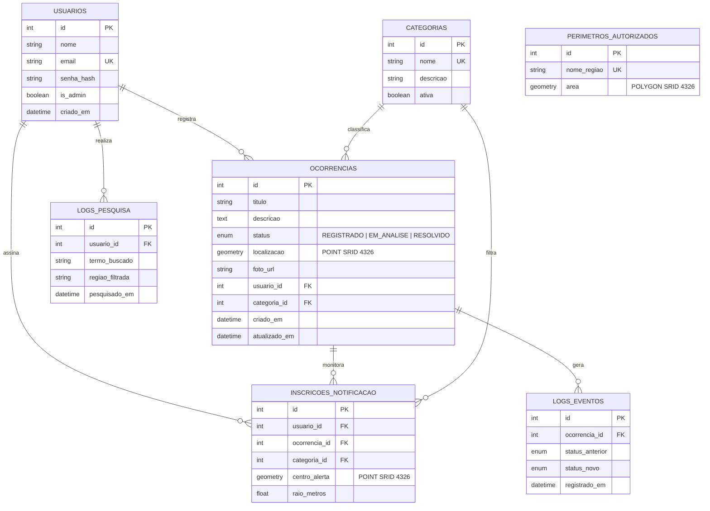

# Arquitetura e Modelagem do Banco de Dados

## 1. Visão Geral da Arquitetura
- **Back-end:** API RESTful em Python 3.11+ (FastAPI), SQLAlchemy e GeoAlchemy2.
- **Banco de Dados:** PostgreSQL 16 + PostGIS 3.4 (SRID 4326).
- **Front-end:** React com Leaflet.js / OpenStreetMap.

## 2. Diagrama Entidade-Relacionamento (DER)

## 3. Rastreabilidade (US01 a US06)
- **US01 / US02:** Tabela ocorrencias armazena coordenadas GPS (POINT) e status.
- **US03:** Tabelas inscricoes_notificacao e logs_eventos gerenciam assinaturas e auditoria de status.
- **US04 / US06:** Consultas sobre ocorrencias e logs_pesquisa geram estatísticas e relatórios gerenciais.
- **US05:** Tabelas categorias e perimetros_autorizados (POLYGON) controlam tipos e áreas válidas.
